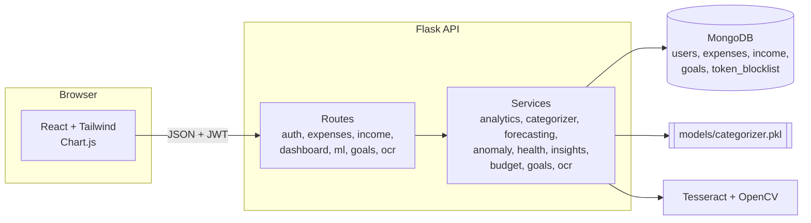

# Architecture

## Layers
1. **Routes** validate input, enforce auth (`@jwt_required`), scope every query by `user_id`, and return JSON.
2. **Services** hold all business and ML logic as pure functions on DataFrames (`analytics.py` is the only module that reads MongoDB). This keeps them unit-testable without a database.
3. **Persistence**: MongoDB with indexes on `(user_id, date)` and `(user_id, category)`.

## Request flow: adding an expense
1. React posts `{description, amount, date}` with the JWT.
2. Route validates fields. If `category` is missing, the categoriser predicts it (`auto_categorized: true`).
3. The document is stored, then the anomaly service checks whether today's total is unusual.
4. The response includes the saved expense and an optional `alert`, which the UI shows as a warning toast.

## Key decisions
- **Per-user models at request time** for forecasting and anomalies: personal data is small, so fitting takes well under a second and avoids storing per-user model files.
- **Global pickled categoriser** because merchant names generalise across users.
- **Complete months only** for forecasting, so a half-finished month never distorts the trend.
- **Token blocklist** with a TTL index gives real logout with stateless JWTs.
