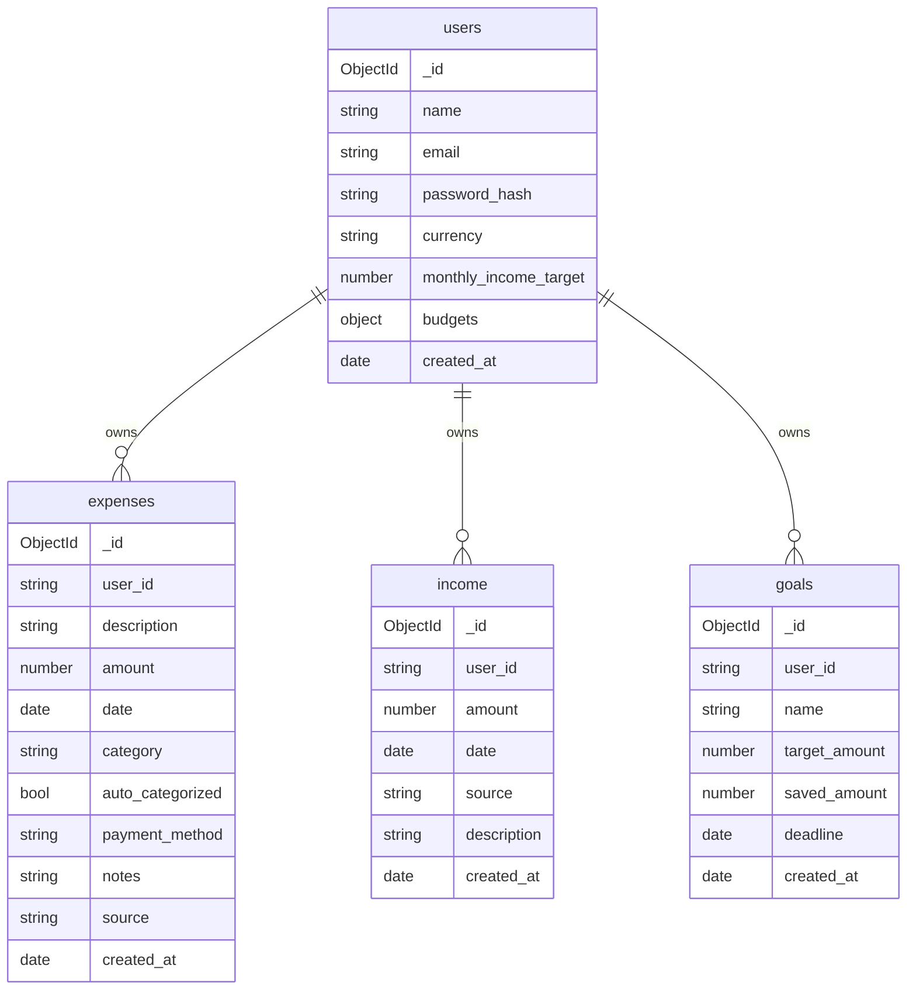

# Database Schema (MongoDB, database `finance_assistant`)

| Collection | Notes | Indexes |
|---|---|---|
| `users` | `email` unique and lower-cased. `budgets` looks like `{"Food": 6000, "Travel": 3000}`. Passwords are stored as salted hashes (Werkzeug). | `email` (unique) |
| `expenses` | `category` is one of the 9 categories. `auto_categorized` is true when the ML model chose it. `source` is `manual`, `ocr` or `seed`. | `(user_id, date desc)`, `(user_id, category)` |
| `income` | `source` is Salary, Freelance, Allowance, Investment, Gift or Other. | `(user_id, date desc)` |
| `goals` | `deadline` is optional. Progress and plan are computed at read time, not stored. | `user_id` |
| `token_blocklist` | Revoked JWT ids from logout. Documents expire automatically after 13 hours. | `created_at` (TTL) |

`user_id` is stored as the string form of the user's `_id`.
